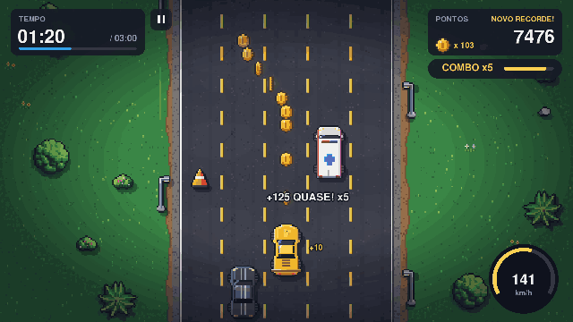
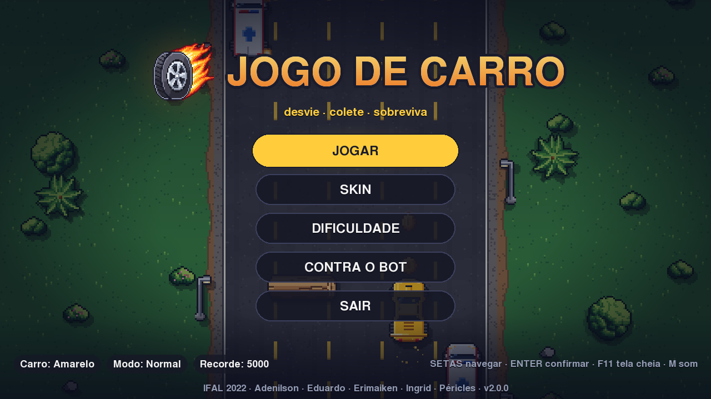
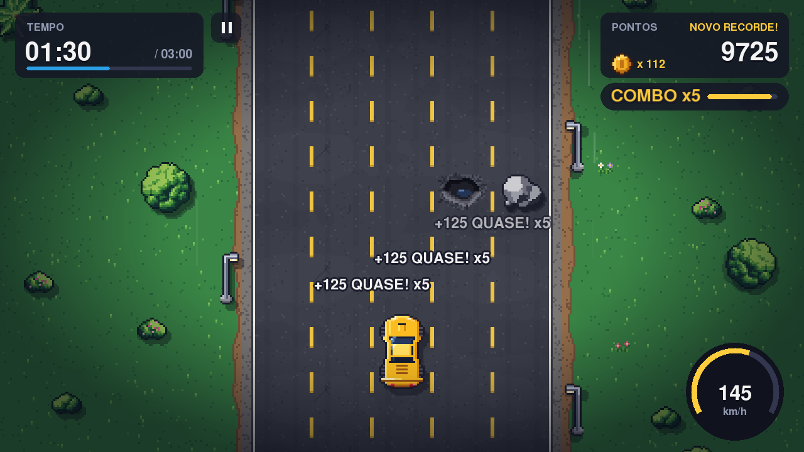
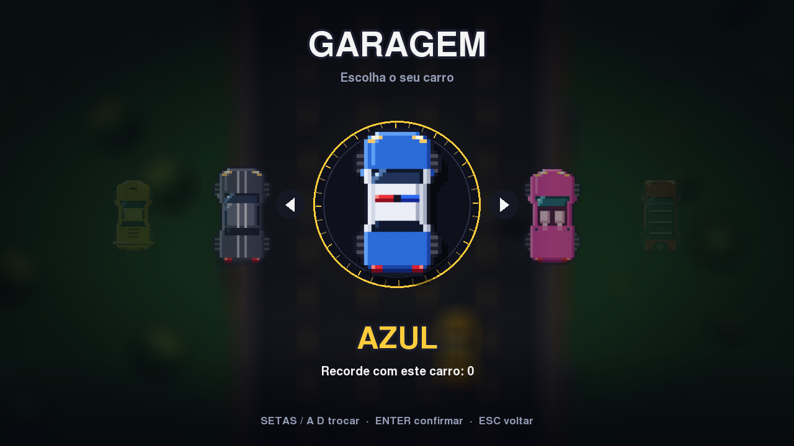
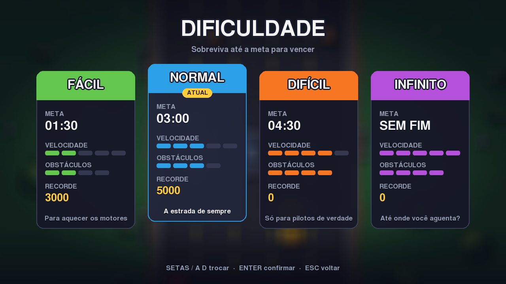
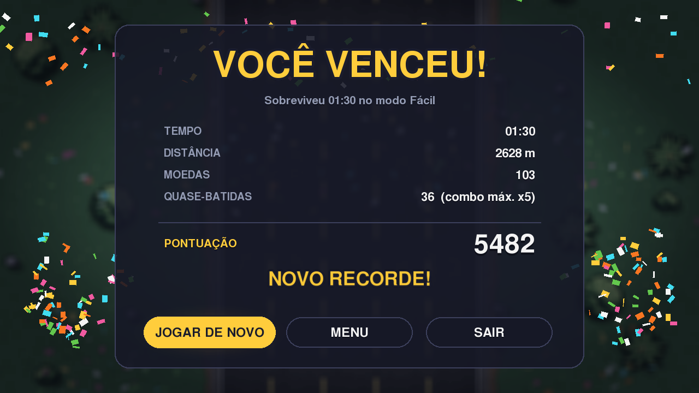

# Jogo de Carro

[](https://github.com/periclesanfe/jogo_de_carro/actions/workflows/ci.yml)

A pixel-art endless runner on a five-lane road: dodge traffic, stones, potholes and rolling logs, grab coins and survive until the clock runs out.

<p align="center">
  
</p>

Originally a 2022 team project at IFAL (Instituto Federal de Alagoas), rebuilt in 2026 on Python 3.14 and pygame-ce with new art, synthesized music, tests and cross-platform releases. The UI is in Brazilian Portuguese.

## Play

**Download:** grab the zip for Windows, macOS (Apple Silicon) or Linux from [Releases](https://github.com/periclesanfe/jogo_de_carro/releases/latest), unzip it and run `jogo-de-carro` (`jogo-de-carro.app` on macOS). The builds are not code-signed, so the first launch needs *More info → Run anyway* on Windows. On macOS, open the app once, then allow it in *System Settings → Privacy & Security → Open Anyway* (or run `xattr -dr com.apple.quarantine jogo-de-carro.app`).

**From source** (Python 3.12+, developed on 3.14; on Windows use `py` instead of `python3`):

```bash
git clone https://github.com/periclesanfe/jogo_de_carro.git
cd jogo_de_carro
python3 -m venv .venv && source .venv/bin/activate  # Windows: .venv\Scripts\activate
pip install -e .
jogo-de-carro                                       # or: python -m jogo_de_carro
```

## Controls

| Action | Keyboard | Gamepad |
| --- | --- | --- |
| Change lane | `A` `D` / `←` `→` | Left stick / D-pad |
| Move up and down | `W` `S` / `↑` `↓` (hold up for +15% score) | Left stick / D-pad |
| Confirm | `Enter` / `Space` | A |
| Back / pause | `Esc` / `P` | B / Start |
| Give up the run | `R` | |
| Mute / fullscreen | `M` / `F11` | |

Menus also work with the mouse, and there is a clickable pause button in the race HUD.

## Modes

The four difficulties keep the win times of the 2022 version. Normal is the default.

| Mode | Survive for | Road |
| --- | --- | --- |
| Fácil | 1:30 | Cars, stones, potholes and cones; vans and rolling logs later on; up to 2 lanes blocked per row |
| Normal | 3:00 | Adds vans, rolling logs and trucks as the run goes on; up to 3 lanes blocked |
| Difícil | 4:30 | Everything from the start, higher top speed; up to 4 lanes blocked |
| Infinito | 30:00 (the run cap) | Speed keeps climbing; 4 lanes can be blocked after 2:00 |

## Features

- Six cars, each with a record of its own, picked on a turntable in the garage.
- Contra o bot: the same road side by side against a FÁCIL, MÉDIO or DIFÍCIL bot; whoever lasts longer wins, then points decide. It sets no records.
- A spawner that always leaves a reachable free lane, sized for the lane-change time at the current speed and kept close to the lane you are in; a test checks 10,000 rows per mode with an independent solver.
- Traffic that signals with a blinker before changing lanes, logs that roll across lanes, potholes that only hurt in the middle.
- Coins, a shield that absorbs one hit, and near misses (dodging at the last moment) that build a combo up to x5.
- Countdown, slow-motion crash with screen shake and sparks, a victory lap with confetti, pause with a blurred backdrop.
- Best score per mode and per car saved as JSON in the user data folder; a corrupt save falls back to defaults.
- Fixed-step simulation (120 Hz) inside an async main loop, so the same code runs in the browser (pygbag).

## Screenshots

<p align="center">
  
  
  
  
  
  
</p>

## What changed in v2

| | 2022 | 2026 |
| --- | --- | --- |
| Runtime | Python 3.10, Pygame 2.1.2 | Python 3.14, pygame-ce 2.5.8 |
| Code | 806 lines, global state in `config.py`, screens that call each other recursively | A package with a scene stack, a fixed-step loop, no mutable globals, type hints |
| Art and audio | Sprites drawn in Piskel, MP3 music | Pixel art, sound effects and music generated by `tools/make_assets.py`, keeping the six car colors and the flaming-tire icon |
| Gameplay | Dodge obstacles, survival timer | Adds lane tweening, a fair spawner, coins, shield, near-miss combos, signalling traffic, countdown, pause, records, gamepad |
| Quality | No tests | pytest suite, Ruff, GitHub Actions |
| Distribution | A ~110 MB Windows build committed to the repository | Zipped builds for Windows, macOS and Linux attached to each release |

The 2022 code is still in the git history (up to commit `7f1a41b`).

## Project structure

```
src/jogo_de_carro/
  app.py              Game: window, fixed-step async loop, global keys
  settings.py         constants, asset manifest, difficulty presets
  assets.py audio.py save.py input.py ui.py tween.py particles.py
  run.py              one race as a pure function of seed and inputs; input logs, replay, validation
  golden.py           determinism digest that the web build and the server must reproduce
  scenes/             title, garage, difficulty, race, versus (contra o bot), pause, results
  world/              road, player, traffic, obstacles, pickups, spawner, scoring, autopilot
  assets/             generated sprites, sounds and music (committed)
  replays/            input logs replayed by golden.py and the tests
  demo.py             scripted tour used for screenshots and the GIF
tests/                spawner fairness, rules, assets, input, drivers, runs and replays, versus, web save, headless smoke test
tools/
  make_assets.py      deterministic generator for every sprite, sound and track
  screenshots.py      renders the demo tour to PNGs
  web_build.py        the browser build (pygbag) into build/www
  pyinstaller_entry.py
web/                  main.py (the browser entry point) and cdn.lock (the pinned pygbag runtime)
ops/                  VPS setup, the deploy script CI runs there, the nginx site
.github/workflows/    ci.yml (lint, tests, web build and its golden gate, deploy), release.yml (PyInstaller builds on v* tags)
```

## Development

```bash
pip install -e ".[dev]"
pytest                              # runs headless; JOGO_STRICT_ASSETS=1 fails on any missing asset
ruff check . && ruff format --check .
python tools/make_assets.py         # regenerate every asset (same seed, same bytes)
python tools/screenshots.py shots   # scripted demo: one PNG per scene plus GIF frames
JOGO_AUTOPILOT=1 python -m jogo_de_carro   # watch the demo play itself
JOGO_RECORD=runs python -m jogo_de_carro   # save every race's input log to runs/<mode>-<seed>.json
python -m jogo_de_carro --replay runs/normal-123.json   # play a saved log back
python -m jogo_de_carro.golden      # print the determinism digest (GOLDEN <sha256>)
```

Set `JOGO_SAVE_DIR` to keep the save file somewhere other than the user data folder. Pushing a `v*` tag builds the three platforms and publishes the release.

## Web build and deploy

The browser version is this package run by [pygbag](https://pygame-web.github.io) 0.9.3 (CPython 3.12.12 and pygame-ce 2.5.7 compiled to WebAssembly), with pygbag's runtime self-hosted:

```bash
pip install pygbag==0.9.3                          # plus ffmpeg on the PATH (the sounds ship as OGG)
python tools/web_build.py                          # writes build/www
python -m http.server 4173 --directory build/www   # open http://localhost:4173/
```

`build/www` is the whole site: `index.html` redirects to `jogo/<tree>/`, the game, named after everything it is built from (`git rev-parse HEAD:src/jogo_de_carro HEAD:web HEAD:tools/web_build.py | git hash-object --stdin`, or `dev` while those have uncommitted changes), and `cdn/` holds pygbag's runtime, checked against `web/cdn.lock`. Everything but the top `index.html` can be cached forever. In the browser the save lives in localStorage, and `?golden=1` on the game's URL logs `GOLDEN <sha256>` to the browser console instead of starting the game.

On pushes to `main` and `web-platform` and on pull requests, CI builds the site and opens `?golden=1` in headless Chrome with every host but localhost blocked: the digest must equal `python -m jogo_de_carro.golden` on CPython 3.12.12. On a push to `main` or `web-platform` it then sends the build to the VPS, where `ops/jogo-deploy` (the deploy key's only command) installs that commit, refuses it unless the VPS's own digest matches too, and publishes it into `/srv/jogo/www` (the entry page moves to it only while that commit is still its branch's newest). One-time VPS setup, as root, from a copy of `ops/` taken outside `/srv/jogo`:

1. `bash setup.sh 'ssh-ed25519 AAAA... jogo-ci'` creates the `jogo` user, the pinned Python, the checkout and `/srv/jogo/www`. Re-run it whenever `ops/` changes.
2. Install `ops/nginx/jogo.conf` as `/etc/nginx/sites-available/jogo`, link it into `sites-enabled`, check it with `nginx -t`, reload nginx, then run the `certbot` line at the top of that file.
3. In the repository's `deploy` environment, set the secrets `DEPLOY_HOST`, `DEPLOY_SSH_KEY` (the private half of that key) and `DEPLOY_KNOWN_HOSTS` (the line `setup.sh` prints). The deploy job is skipped until `DEPLOY_HOST` exists.

## Credits

The original 2022 game was made by:

- [Adenilson Silva dos Santos](https://github.com/adenilson666)
- [Eduardo Pedro da Silva](https://github.com/eduardopedro2)
- [Erimaiken Batista dos Santos](https://github.com/M4iKen)
- [Ingrid Mônica da Silva Bezerra](https://github.com/ingridmonica)
- [Péricles Andrade Feitoza](https://github.com/periclesanfe)

v2 modernization by Péricles Feitoza.
